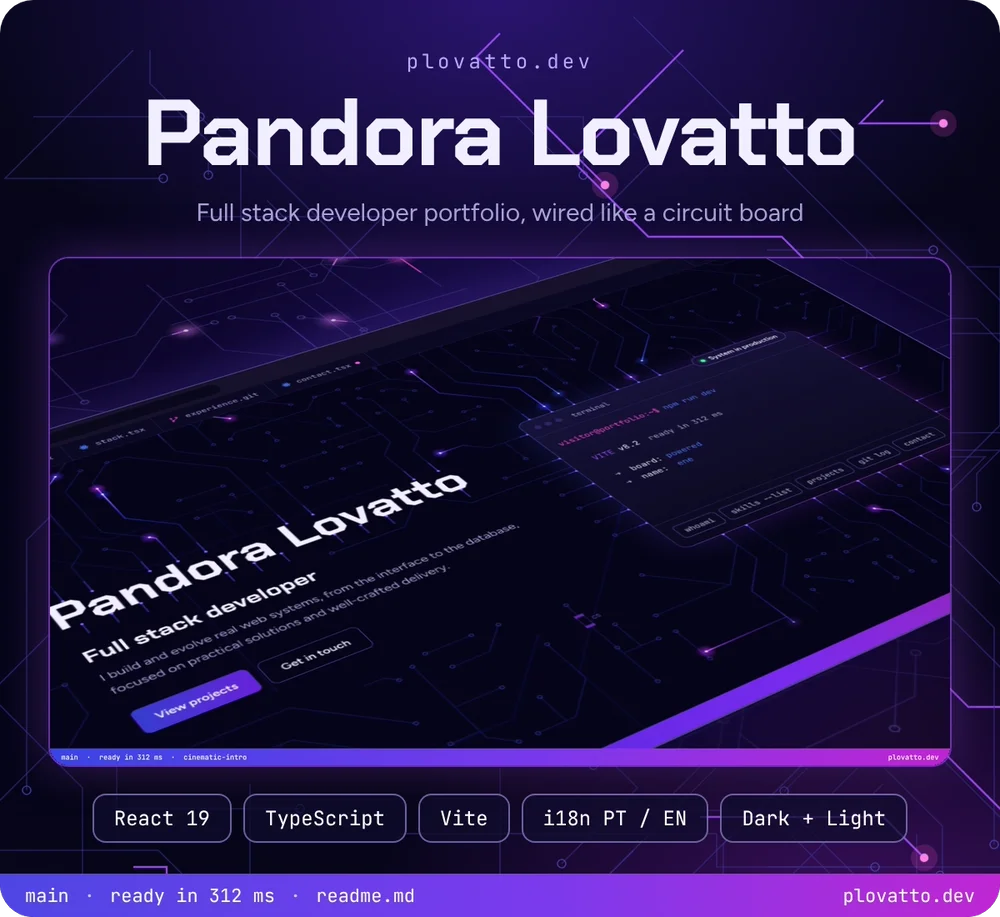
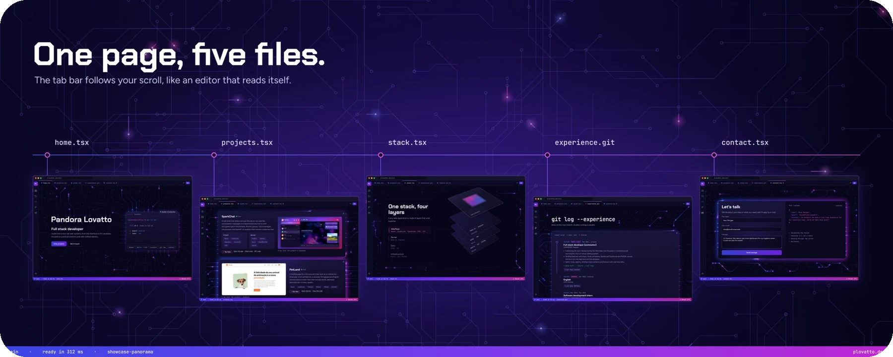
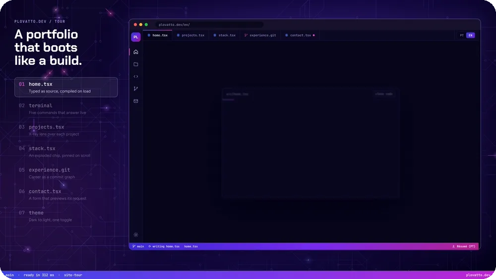
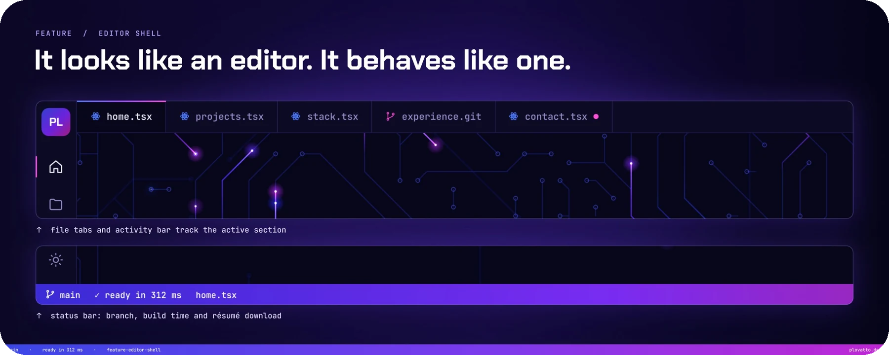
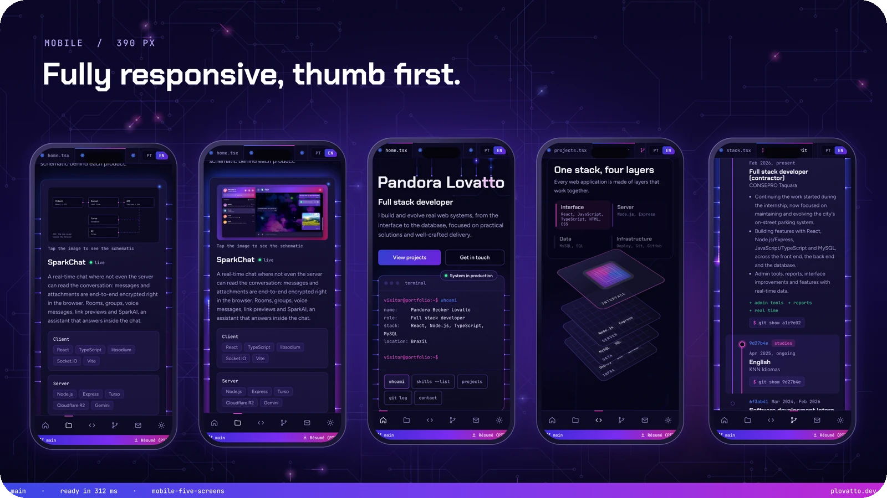
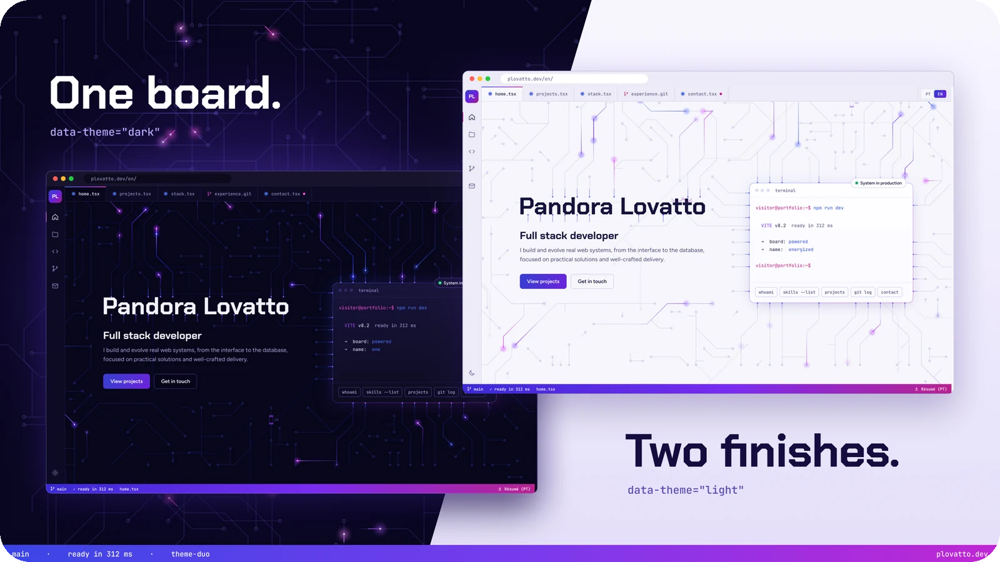
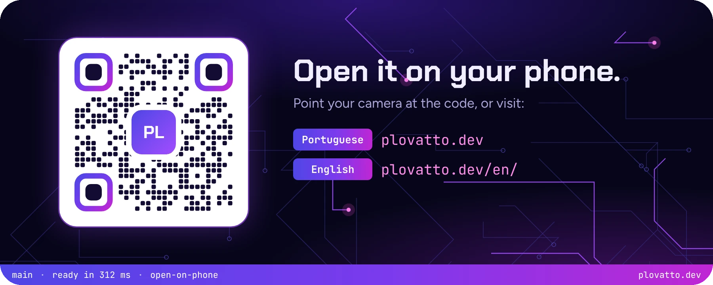
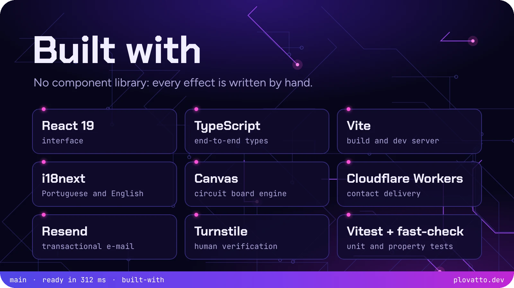
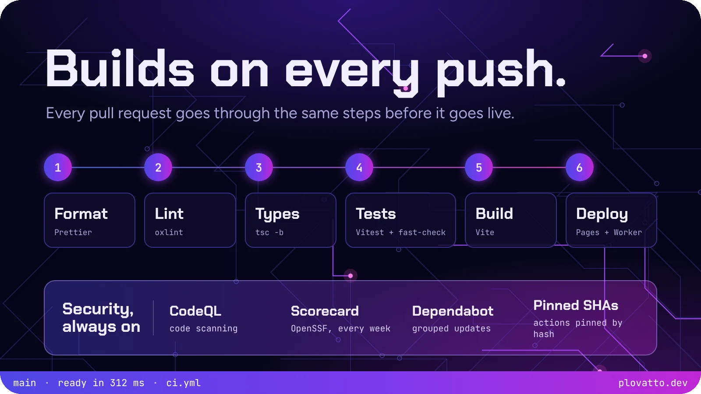

<div align="center">
  <a href="https://plovatto.dev/en/">
    <picture>
      <source media="(prefers-reduced-motion: reduce)" srcset="./.github/assets/hero-still-en.webp">
      
    </picture>
  </a>

  <br>
  <br>

<a href="https://plovatto.dev/en/"></a>
&nbsp;
<a href="README.pt-BR.md"></a>

  <br>
  <br>

<a href="https://github.com/Plovatto/Portfolio/actions/workflows/ci.yml"></a>
<a href="https://github.com/Plovatto/Portfolio/actions/workflows/tests.yml"></a>
<a href="https://scorecard.dev/viewer/?uri=github.com/Plovatto/Portfolio"></a>
<a href="https://www.bestpractices.dev/projects/16066"></a>
<a href="LICENSE"></a>
</div>

<br>

<p align="center">The personal portfolio of Pandora Becker Lovatto, full stack developer. Every section is mounted as a chip on a procedurally routed circuit board, inside an interface that looks and behaves like a code editor.</p>

<br>

<details>
<summary><strong>Table of contents</strong></summary>

- [Overview](#overview)
- [See it in motion](#see-it-in-motion)
- [It looks like an editor. It behaves like one.](#it-looks-like-an-editor-it-behaves-like-one)
- [Fully responsive, thumb first](#fully-responsive-thumb-first)
- [One board, two finishes](#one-board-two-finishes)
- [Open it on your phone](#open-it-on-your-phone)
- [Features](#features)
- [Tech stack](#tech-stack)
- [Quality and security](#quality-and-security)
- [Getting started](#getting-started)
- [Scripts](#scripts)
- [Project structure](#project-structure)
- [Deployment](#deployment)
- [Contributing](#contributing)
- [Security](#security)
- [Changelog](#changelog)
- [Author](#author)
- [License](#license)

</details>

## Overview

One page, five files: the tab bar follows your scroll, like an editor that reads itself.



## See it in motion

The site boots like a build: the hero is typed as code, compiled, and wired into the board, then every section powers on as you scroll.

<picture>
  <source media="(prefers-reduced-motion: reduce)" srcset="./.github/assets/tour-still.webp">
  
</picture>

## It looks like an editor. It behaves like one.

File tabs and the activity bar track the active section, and the status bar shows the branch, the build time, and the résumé download.



## Fully responsive, thumb first

On phones, the activity bar becomes a bottom navigation bar and every section is laid out for one hand.



## One board, two finishes

A dark and a light theme share the same circuit board, switched with one toggle.



## Open it on your phone

The site is live at plovatto.dev in both languages.

<a href="https://plovatto.dev/en/"></a>

## Features

Every interaction is written by hand, with no component library.

<table>
  <tr>
    <td width="50%" valign="top">
      <p><br><strong>Editor shell</strong><br>An activity bar, file tabs, and a status bar that follow the scroll, plus a tab title that marks unsaved changes while you are away.</p>
      <br>
      <p><br><strong>Interactive terminal</strong><br>Run <code>whoami</code>, <code>skills --list</code>, <code>projects</code>, <code>git log</code>, and <code>contact</code> right in the hero.</p>
      <br>
      <p><br><strong>Career as a commit graph</strong><br>Each period of the career is a commit that opens a <code>git show</code> diff.</p>
    </td>
    <td width="50%" valign="top">
      <p><br><strong>A living circuit board</strong><br>Traces routed at runtime, pulses roaming the board, clicks that send current waves, and cards that power on as you scroll.</p>
      <br>
      <p><br><strong>Projects with an x-ray lens</strong><br>A schematic lens over each screenshot and a live preview window that runs the project inside the page.</p>
      <br>
      <p><br><strong>A contact form that delivers</strong><br>A live request preview, human verification, and delivery feedback, sent through a Cloudflare Worker.</p>
    </td>
  </tr>
</table>

<details>
<summary>See every feature</summary>

- Opening animation where the hero is typed as source code, compiled, and flown into the title
- The stack as an exploded chip that separates layer by layer while pinned
- Portuguese at `/` and English at `/en/`, each with its own title, description, canonical, `hreflang`, and JSON-LD generated at build time, plus an animated language switch that keeps the URL in sync. Visitors are sent to their system language on arrival unless they picked one on the switch; search engines and link previews are never redirected
- Privacy-first analytics: Google Analytics 4 and Microsoft Clarity load only after the visitor accepts the cookie notice, with Consent Mode v2 denied by default and a privacy page in both languages
- Light and dark themes, custom cursors, and résumé download
- Accessible and fast: skip link, reduced motion support, self-hosted fonts, responsive images, and a low-power mode for slow devices

</details>

## Tech stack

React and TypeScript on the page, a Cloudflare Worker behind the contact form.



<details>
<summary>See every tool and what it is used for</summary>

| Technology                                                                                                                                            | Used for                               |
| :---------------------------------------------------------------------------------------------------------------------------------------------------- | :------------------------------------- |
| [React](https://react.dev/) 19 + [TypeScript](https://www.typescriptlang.org/)                                                                        | Interface and typed components         |
| [Vite](https://vite.dev/)                                                                                                                             | Development server and build           |
| [i18next](https://www.i18next.com/) + [react-i18next](https://react.i18next.com/)                                                                     | Internationalization                   |
| Canvas API                                                                                                                                            | Circuit board engine                   |
| [Cloudflare Workers](https://workers.cloudflare.com/), [Resend](https://resend.com/), and [Turnstile](https://www.cloudflare.com/products/turnstile/) | Contact form delivery and verification |
| [Vitest](https://vitest.dev/) + [fast-check](https://fast-check.dev/)                                                                                 | Unit and property-based tests          |
| [oxlint](https://oxc.rs/) + [Prettier](https://prettier.io/)                                                                                          | Linting and formatting                 |
| GitHub Actions + GitHub Pages                                                                                                                         | CI, automated deployment, and hosting  |

</details>

## Quality and security

Every pull request goes through the same steps before it goes live.



<details>
<summary>How each check works</summary>

- [`ci.yml`](.github/workflows/ci.yml) checks formatting, lint, types, and the build for the site, and types for the worker, on every push and pull request to `main`.
- [`tests.yml`](.github/workflows/tests.yml) runs the unit tests for the site and the worker.
- [CodeQL](https://github.com/Plovatto/Portfolio/security/code-scanning) scans the code, and the [OpenSSF Scorecard](https://scorecard.dev/viewer/?uri=github.com/Plovatto/Portfolio) runs every week.
- [Lighthouse CI](.github/workflows/lighthouse.yml) audits `/` and `/en/` on every pull request and fails if accessibility, best practices, or SEO drop below 95.
- Pull request titles are checked against the same gitmoji and Conventional Commits format as the commits.
- Dependabot groups npm updates weekly and GitHub Actions updates monthly.
- Every action in the workflows is pinned to a commit hash.

</details>

## Getting started

Requires [Node.js](https://nodejs.org/) 22.12 or newer (see [`.nvmrc`](.nvmrc)) and npm.

1. Clone the repository and install the dependencies:

   ```bash
   git clone https://github.com/Plovatto/Portfolio.git
   cd Portfolio
   npm install
   ```

2. Copy the environment file:

   ```bash
   cp .env.example .env.local
   ```

3. Start the development server and open <http://localhost:5173>:

   ```bash
   npm run dev
   ```

| Variable                  | Description                                                                         |
| :------------------------ | :---------------------------------------------------------------------------------- |
| `VITE_CONTACT_ENDPOINT`   | URL of the contact Worker (see [`worker/README.md`](worker/README.md))              |
| `VITE_TURNSTILE_SITE_KEY` | Public Turnstile site key; the example value is Cloudflare's test key, which passes |
| `VITE_GA_ID`              | Google Analytics 4 measurement ID (`G-XXXXXXX`); optional                           |
| `VITE_CLARITY_ID`         | Microsoft Clarity project ID; optional                                              |

> [!NOTE]
> Without an endpoint, the form still validates, and sending shows an error. Without the analytics IDs, nothing is loaded and the cookie notice never appears.

## Scripts

| Command                | Description                                |
| :--------------------- | :----------------------------------------- |
| `npm run dev`          | Starts the development server              |
| `npm run build`        | Type-checks and builds for production      |
| `npm run preview`      | Serves the production build locally        |
| `npm run lint`         | Runs oxlint                                |
| `npm run typecheck`    | Type-checks the project                    |
| `npm test`             | Runs the unit tests                        |
| `npm run format`       | Formats the code with Prettier             |
| `npm run format:check` | Checks the formatting                      |
| `npm run lighthouse`   | Runs Lighthouse CI on the production build |

## Project structure

<details>
<summary>View the folder tree</summary>

```text
src/
├─ components/
│  ├─ CircuitBackground/   # canvas board engine: routing, pulses, waves, pinned sections
│  ├─ layout/              # editor chrome: activity bar, tabs, status bar, footer
│  ├─ sections/            # Hero, Projects, Stack, Experience, Contact
│  └─ ui/                  # Chip, Icon, SectionHead, SectionDivider, WindowDialog
├─ constants/              # profile, projects, stack, experience and navigation data
├─ context/                # theme context
├─ hooks/                  # useTheme, useReveal, useActiveSection, useReducedMotion, useConsent
├─ lib/                    # contact, turnstile, consent, analytics, typewriter and other helpers
├─ locales/                # Portuguese and English translations
├─ styles/index.css        # design tokens, base styles and entrance motion
├─ i18n.ts
├─ App.tsx
└─ main.tsx
public/                    # icons, résumé, project images, social preview, sitemap, robots, llms.txt, privacy page, 404
worker/                    # Cloudflare Worker that delivers the contact e-mail
seo/                       # build-time page metadata for each language
```

</details>

## Deployment

<details>
<summary>How the site and the Worker are published</summary>

The site is published to GitHub Pages and the contact Worker to Cloudflare, both through GitHub Actions.

| Workflow            | Runs on                               | Does                                                                           |
| :------------------ | :------------------------------------ | :----------------------------------------------------------------------------- |
| `ci.yml`            | pull requests and pushes to `main`    | format check, lint, typecheck and build for the site; typecheck for the worker |
| `tests.yml`         | pull requests and pushes to `main`    | unit tests for the site and the worker                                         |
| `deploy-site.yml`   | pushes to `main` (outside `worker/`)  | lint, tests, build and deploy to GitHub Pages                                  |
| `deploy-worker.yml` | pushes to `main` that touch `worker/` | typecheck, tests and `wrangler deploy`                                         |
| `scorecard.yml`     | pushes to `main` and weekly           | OpenSSF Scorecard security analysis                                            |

The site is served from the root of `plovatto.dev`, so the deploy workflow builds with `VITE_BASE=/`. Without it, production builds fall back to the `/Portfolio/` base path.

One-time setup in the repository settings:

1. **Pages → Source:** GitHub Actions, with `plovatto.dev` as the custom domain and HTTPS enforced.
2. **Secrets and variables → Actions → Variables:** `VITE_CONTACT_ENDPOINT`, `VITE_TURNSTILE_SITE_KEY` and, to enable analytics, `VITE_GA_ID` and `VITE_CLARITY_ID`. All of them end up in the public bundle, so they are variables, not secrets.
3. **Secrets:** `CLOUDFLARE_API_TOKEN` (template "Edit Cloudflare Workers") and `CLOUDFLARE_ACCOUNT_ID`, used only by the worker deploy. The worker's own secrets (`CONTACT_TO`, `RESEND_API_KEY`, `TURNSTILE_SECRET`) stay in Cloudflare.
4. **Cloudflare Turnstile:** add `plovatto.dev` to the widget hostnames.

</details>

## Contributing

Issues and pull requests are welcome. Read the [contributing guide](CONTRIBUTING.md) for the branch, commit, and pull request conventions, and follow the [code of conduct](CODE_OF_CONDUCT.md).

## Security

Please do not open public issues for vulnerabilities. Report them privately as described in the [security policy](SECURITY.md).

## Changelog

Notable changes for each release are listed in the [CHANGELOG](CHANGELOG.md) and on the [releases page](https://github.com/Plovatto/Portfolio/releases).

## Author

**Pandora Becker Lovatto** · [@Plovatto](https://github.com/Plovatto) · [plovatto.dev](https://plovatto.dev/en/)

## License

Distributed under the [MIT License](LICENSE).

<br>

<p align="center"><a href="#readme"></a></p>
