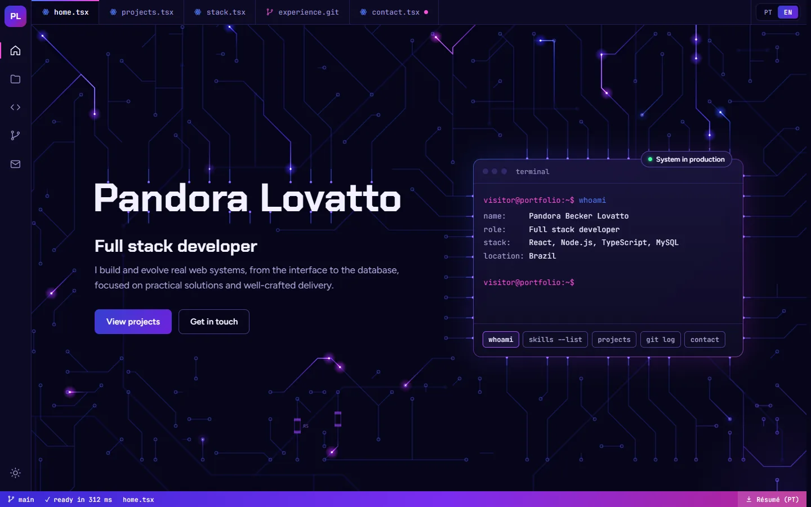
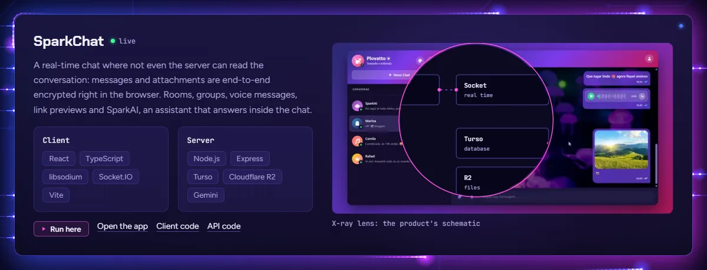
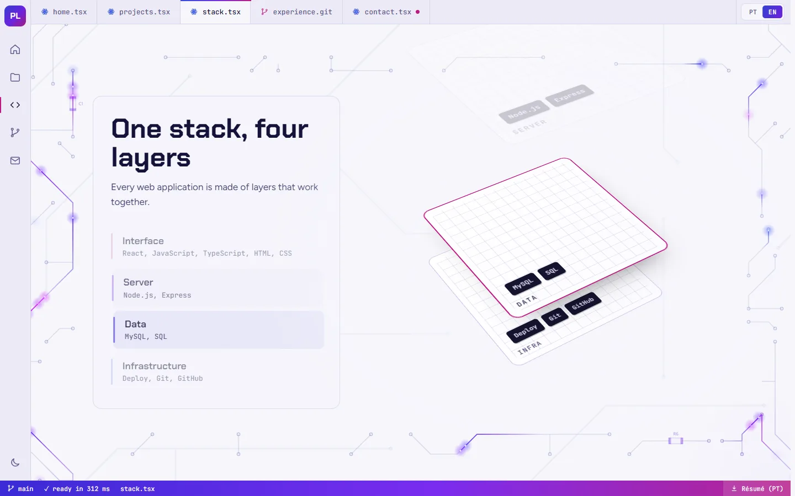
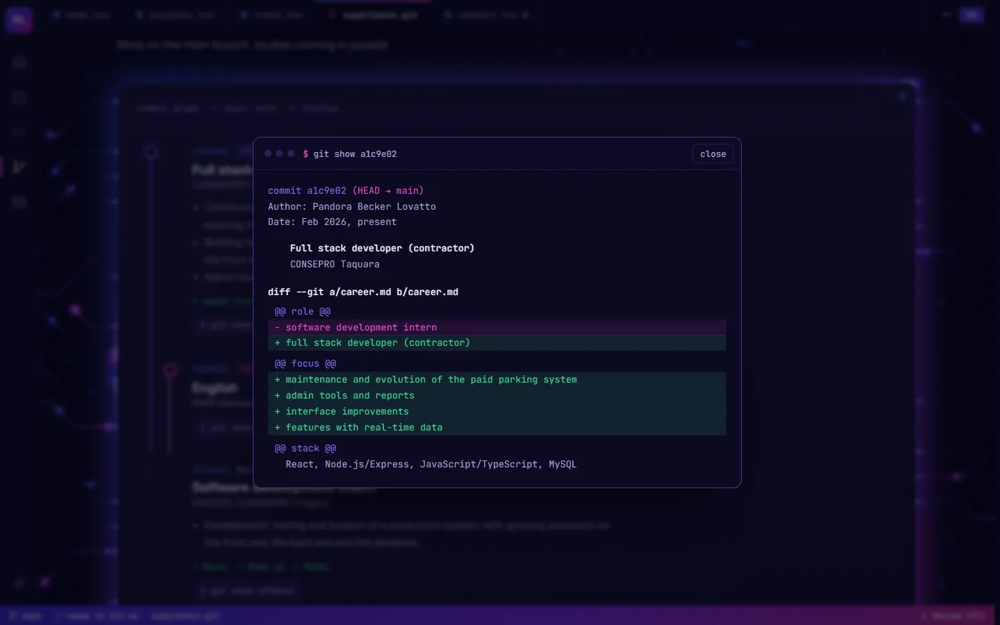
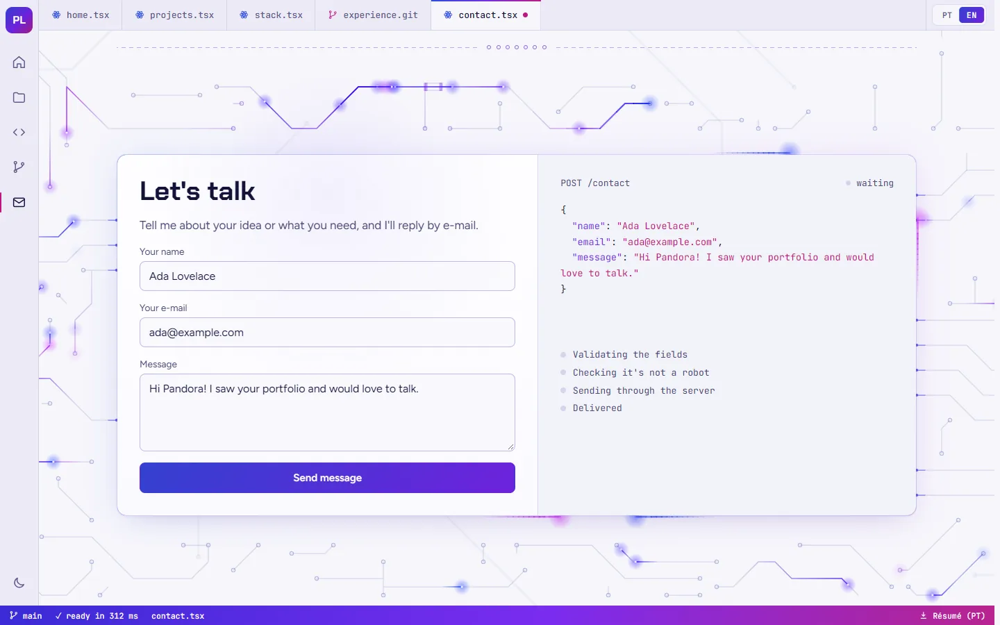
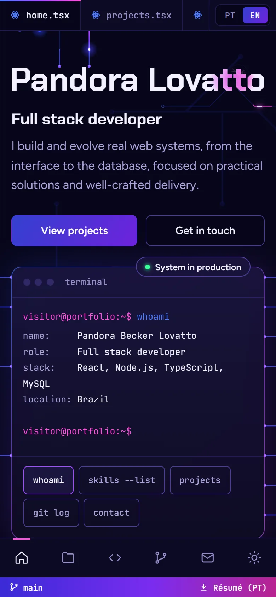
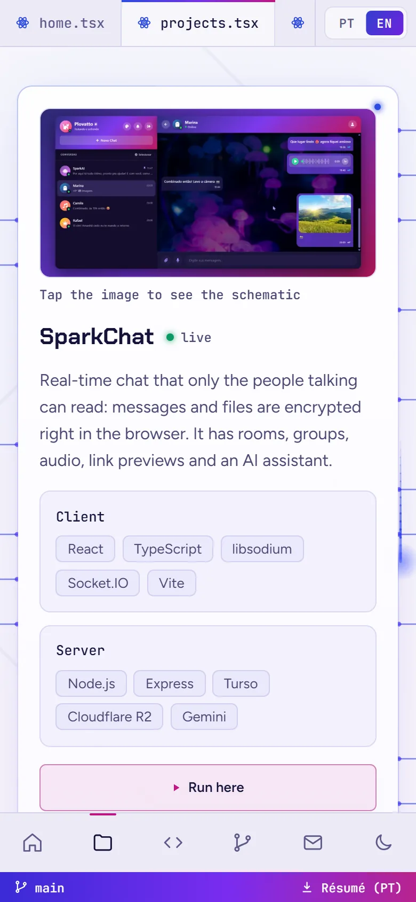

# Pandora Lovatto · Portfolio

[](https://github.com/Plovatto/portifolio/actions/workflows/ci.yml)
[](https://github.com/Plovatto/portifolio/actions/workflows/tests.yml)
[](https://github.com/Plovatto/portifolio/actions/workflows/deploy-site.yml)
[](LICENSE)

Personal portfolio of Pandora Becker Lovatto, full stack developer. The page is a living circuit board built with React, TypeScript and Vite: every section is mounted as a chip on a procedurally routed PCB, inside an interface that looks and behaves like a code editor.

**Live site:** https://plovatto.github.io/portifolio/

<p align="center">
  
</p>

<p align="center"><em>The hero is written as code, compiled on load and wired into the board</em></p>

<table>
  <tr>
    <td width="50%"></td>
    <td width="50%"></td>
  </tr>
  <tr>
    <td align="center"><em>Projects with an x-ray schematic lens</em></td>
    <td align="center"><em>The stack as a pinned exploded chip</em></td>
  </tr>
  <tr>
    <td width="50%"></td>
    <td width="50%"></td>
  </tr>
  <tr>
    <td align="center"><em>Each career commit opens a <code>git show</code> diff</em></td>
    <td align="center"><em>Contact form with a live request preview</em></td>
  </tr>
</table>

<p align="center">
  
  &nbsp;&nbsp;
  
</p>

<p align="center"><em>Fully responsive, with a bottom navigation bar on phones</em></p>

## Features

- Editor-style shell with an activity bar, file tabs and a status bar that follow the scroll
- Opening animation where the hero is typed as source code, compiled and flown into the title
- Circuit board background routed at runtime: pulses roam the traces, clicks send current waves and each card powers on as you scroll
- Interactive terminal with `whoami`, `skills --list`, `projects`, `git log` and `contact`
- Project cards with an x-ray lens over the screenshot and a live preview window that runs each project inside the page
- The stack as an exploded chip that separates layer by layer while pinned
- Career rendered as a git commit graph, with a `git show` diff for every period
- Contact form with a live request preview, human verification and delivery feedback, sent through a Cloudflare Worker
- Portuguese and English, detected from the browser, with an animated language switch
- Light and dark themes, custom cursors, résumé download and a tab title that marks unsaved changes while you are away
- Accessible and fast: skip link, reduced motion support, self-hosted fonts, responsive images and a low-power mode for slow devices

## Tech stack

- [React](https://react.dev/) 19
- [TypeScript](https://www.typescriptlang.org/)
- [Vite](https://vite.dev/)
- [Tailwind CSS](https://tailwindcss.com/) 4
- [i18next](https://www.i18next.com/) and [react-i18next](https://react.i18next.com/)
- [Vitest](https://vitest.dev/) for unit tests
- [Cloudflare Workers](https://workers.cloudflare.com/), [Resend](https://resend.com/) and [Turnstile](https://www.cloudflare.com/products/turnstile/) for the contact form
- [oxlint](https://oxc.rs/) and [Prettier](https://prettier.io/) for linting and formatting

## Getting started

### Prerequisites

- [Node.js](https://nodejs.org/) 22.12 or newer
- npm

### Installation

Clone the repository:

```bash
git clone https://github.com/Plovatto/portifolio.git
```

Go to the project folder:

```bash
cd portifolio
```

Install the dependencies:

```bash
npm install
```

### Environment variables

Copy `.env.example` to `.env.local` and fill in:

| Variable                  | Description                                                                         |
| ------------------------- | ----------------------------------------------------------------------------------- |
| `VITE_CONTACT_ENDPOINT`   | URL of the contact Worker (see [`worker/README.md`](worker/README.md))              |
| `VITE_TURNSTILE_SITE_KEY` | Public Turnstile site key; the example value is Cloudflare's test key, which passes |

Without an endpoint the form still validates, and sending shows an error.

### Running

Start the development server:

```bash
npm run dev
```

## Scripts

| Command                | Description                           |
| ---------------------- | ------------------------------------- |
| `npm run dev`          | Starts the development server         |
| `npm run build`        | Type-checks and builds for production |
| `npm run preview`      | Serves the production build locally   |
| `npm run lint`         | Runs oxlint                           |
| `npm run typecheck`    | Type-checks the project               |
| `npm test`             | Runs the unit tests                   |
| `npm run format`       | Formats the code with Prettier        |
| `npm run format:check` | Checks the formatting                 |

## Project structure

```
src/
├─ components/
│  ├─ CircuitBackground/   # canvas board engine: routing, pulses, waves, pinned sections
│  ├─ layout/              # editor chrome: activity bar, tabs, status bar, footer
│  ├─ sections/            # Hero, Projects, Stack, Experience, Contact
│  └─ ui/                  # Chip, Icon, SectionHead, SectionDivider, WindowDialog
├─ constants/              # profile, projects, stack, experience and navigation data
├─ context/                # theme context
├─ hooks/                  # useTheme, useReveal, useActiveSection, useReducedMotion
├─ lib/                    # contact, turnstile, typewriter, scramble, tween and other helpers
├─ locales/                # Portuguese and English translations
├─ styles/index.css        # design tokens, base styles and entrance motion
├─ i18n.ts
├─ App.tsx
└─ main.tsx
public/                    # icons, résumé, project images, social preview, sitemap, 404
worker/                    # Cloudflare Worker that delivers the contact e-mail
docs/screenshots/          # images used in this README
```

## Deploy

The site is published to GitHub Pages and the contact Worker to Cloudflare, both through GitHub Actions.

| Workflow            | Runs on                               | Does                                                                           |
| ------------------- | ------------------------------------- | ------------------------------------------------------------------------------ |
| `ci.yml`            | pull requests and pushes to `main`    | format check, lint, typecheck and build for the site; typecheck for the worker |
| `tests.yml`         | pull requests and pushes to `main`    | unit tests for the site and the worker                                         |
| `deploy-site.yml`   | pushes to `main` (outside `worker/`)  | lint, tests, build and deploy to GitHub Pages                                  |
| `deploy-worker.yml` | pushes to `main` that touch `worker/` | typecheck, tests and `wrangler deploy`                                         |

Production builds use the `/portifolio/` base path; override it with `VITE_BASE`.

One-time setup in the repository settings:

1. **Pages → Source:** GitHub Actions.
2. **Secrets and variables → Actions → Variables:** `VITE_CONTACT_ENDPOINT` and `VITE_TURNSTILE_SITE_KEY`. Both end up in the public bundle, so they are variables, not secrets.
3. **Secrets:** `CLOUDFLARE_API_TOKEN` (template "Edit Cloudflare Workers") and `CLOUDFLARE_ACCOUNT_ID`, used only by the worker deploy. The worker's own secrets (`CONTACT_TO`, `RESEND_API_KEY`, `TURNSTILE_SECRET`) stay in Cloudflare.
4. **Cloudflare Turnstile:** add `plovatto.github.io` to the widget hostnames.

## License

Released under the [MIT License](LICENSE).
