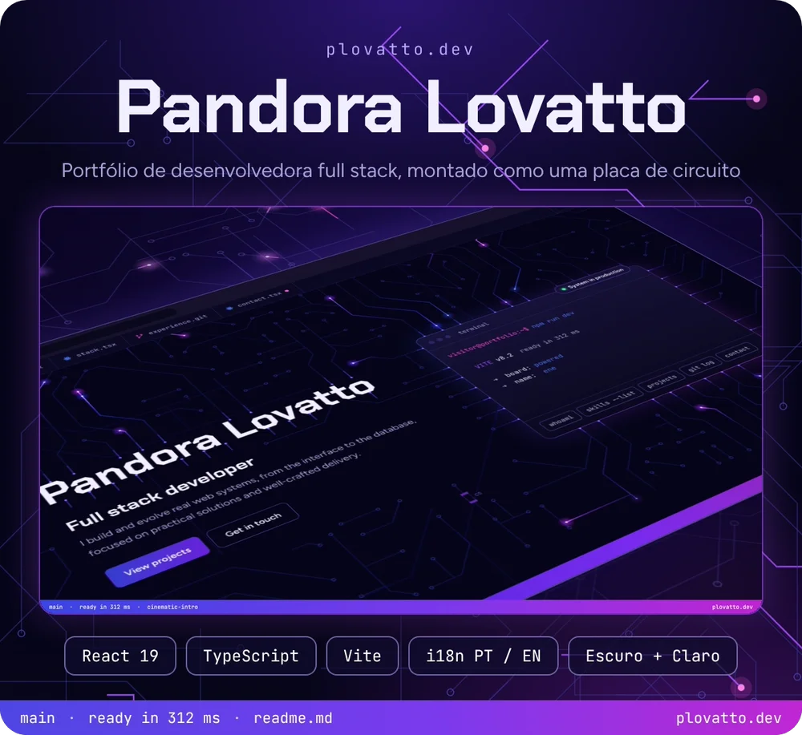
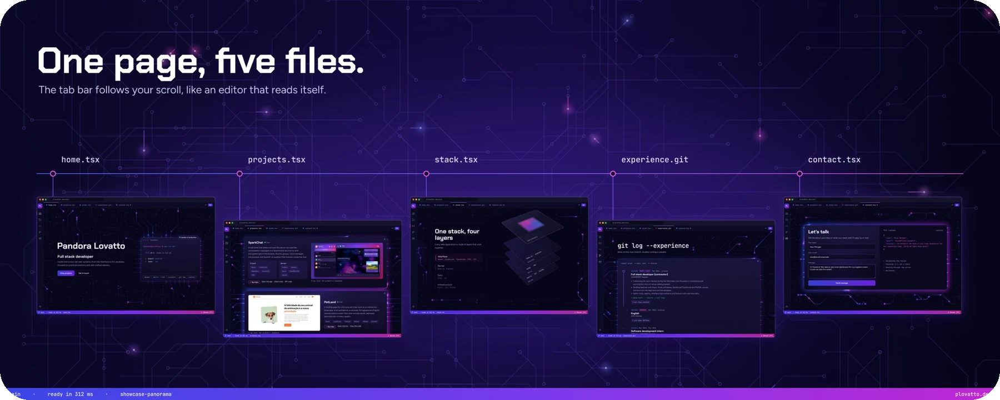
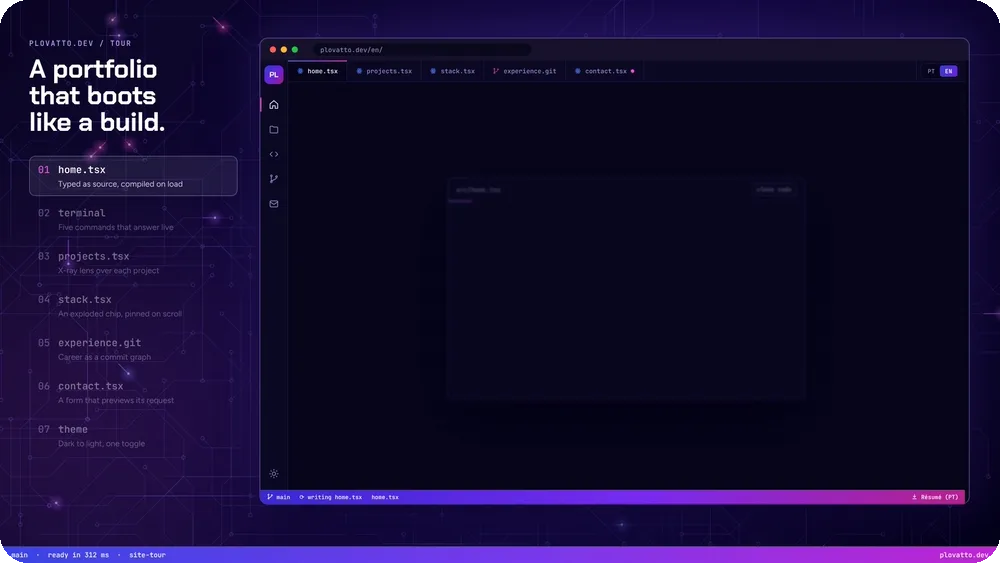
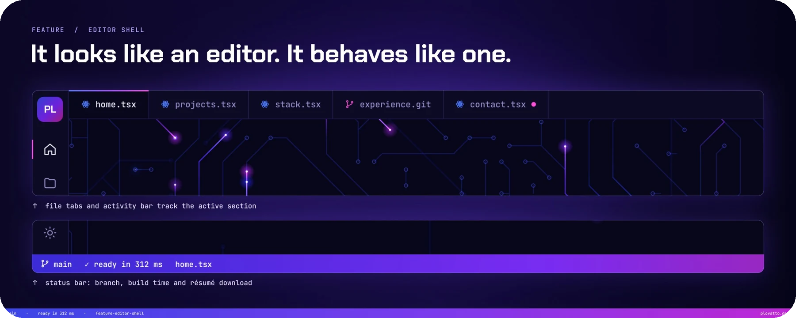
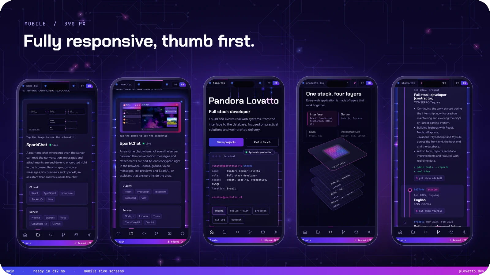
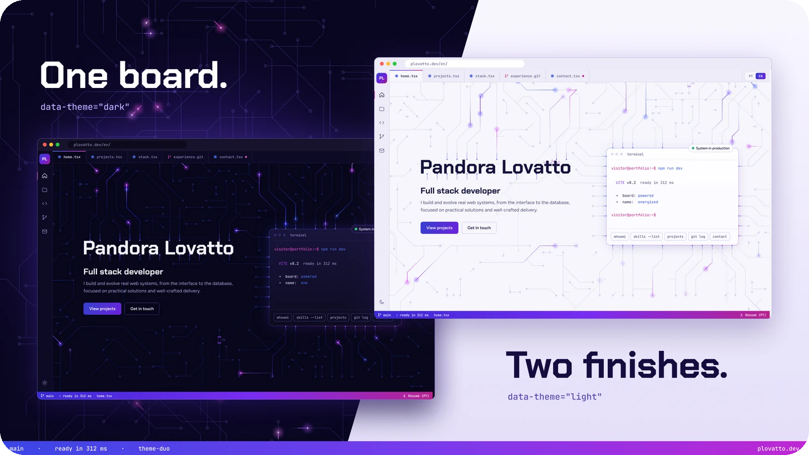
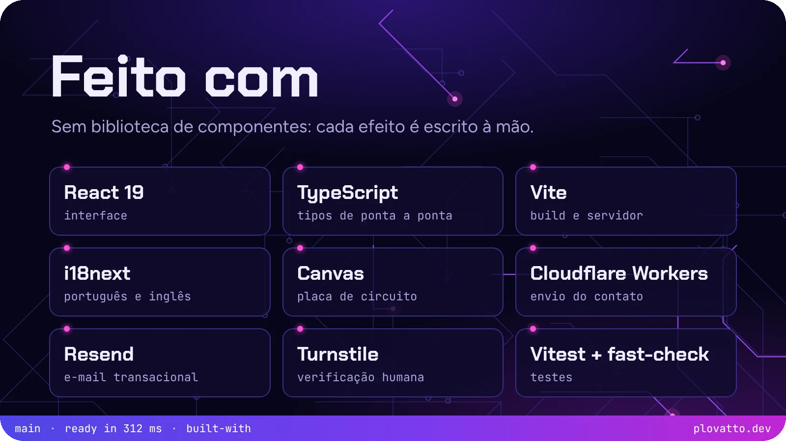
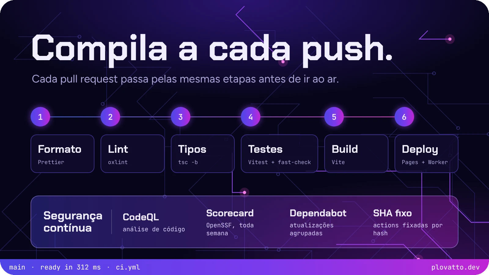

<div align="center">
  <a href="https://plovatto.dev/">
    <picture>
      <source media="(prefers-reduced-motion: reduce)" srcset="./.github/assets/hero-still-pt.webp">
      
    </picture>
  </a>

  <br>
  <br>

<a href="https://plovatto.dev/"></a>
&nbsp;
<a href="README.md"></a>

  <br>
  <br>

<a href="https://github.com/Plovatto/Portfolio/actions/workflows/ci.yml"></a>
<a href="https://github.com/Plovatto/Portfolio/actions/workflows/tests.yml"></a>
<a href="https://scorecard.dev/viewer/?uri=github.com/Plovatto/Portfolio"></a>
<a href="https://www.bestpractices.dev/projects/16066"></a>
<a href="LICENSE"></a>
</div>

<br>

<p align="center">O portfólio pessoal de Pandora Becker Lovatto, desenvolvedora full stack. Cada seção é montada como um chip numa placa de circuito roteada por código, dentro de uma interface que parece e funciona como um editor de código.</p>

<br>

<details>
<summary><strong>Sumário</strong></summary>

- [Visão geral](#visão-geral)
- [Veja em movimento](#veja-em-movimento)
- [Parece um editor. Funciona como um.](#parece-um-editor-funciona-como-um)
- [Responsivo, feito para o polegar](#responsivo-feito-para-o-polegar)
- [Uma placa, dois acabamentos](#uma-placa-dois-acabamentos)
- [Abra no celular](#abra-no-celular)
- [Funcionalidades](#funcionalidades)
- [Tecnologias](#tecnologias)
- [Qualidade e segurança](#qualidade-e-segurança)
- [Como executar](#como-executar)
- [Scripts](#scripts)
- [Estrutura do projeto](#estrutura-do-projeto)
- [Deploy](#deploy)
- [Contribuição](#contribuição)
- [Segurança](#segurança)
- [Histórico de versões](#histórico-de-versões)
- [Autoria](#autoria)
- [Licença](#licença)

</details>

## Visão geral

Uma página, cinco arquivos: a barra de abas acompanha a rolagem, como um editor que lê a si mesmo.



## Veja em movimento

O site inicia como um build: o hero é digitado como código, compilado e ligado à placa, e cada seção acende conforme você rola.

<picture>
  <source media="(prefers-reduced-motion: reduce)" srcset="./.github/assets/tour-still.webp">
  
</picture>

## Parece um editor. Funciona como um.

As abas de arquivo e a barra de atividades acompanham a seção ativa, e a barra de status mostra a branch, o tempo de build e o download do currículo.



## Responsivo, feito para o polegar

No celular, a barra de atividades vira uma navegação inferior e cada seção é organizada para usar com uma mão.



## Uma placa, dois acabamentos

Os temas escuro e claro compartilham a mesma placa de circuito e se alternam com um botão.



## Abra no celular

O site está no ar em plovatto.dev, nos dois idiomas.

<a href="https://plovatto.dev/"></a>

## Funcionalidades

Cada interação é escrita à mão, sem biblioteca de componentes.

<table>
  <tr>
    <td width="50%" valign="top">
      <p><br><strong>Interface de editor</strong><br>Barra de atividades, abas de arquivo e barra de status que acompanham a rolagem, e um título de aba que marca alterações não salvas enquanto você está fora.</p>
      <br>
      <p><br><strong>Terminal interativo</strong><br>Rode <code>whoami</code>, <code>skills --list</code>, <code>projects</code>, <code>git log</code> e <code>contact</code> direto no hero.</p>
      <br>
      <p><br><strong>Carreira como grafo de commits</strong><br>Cada período da carreira é um commit que abre um diff de <code>git show</code>.</p>
    </td>
    <td width="50%" valign="top">
      <p><br><strong>Uma placa de circuito viva</strong><br>Trilhas roteadas em tempo real, pulsos percorrendo a placa, cliques que enviam ondas de corrente e cartões que acendem conforme a rolagem.</p>
      <br>
      <p><br><strong>Projetos com lente de raio-x</strong><br>Uma lente de esquema sobre cada captura e uma janela que roda o projeto dentro da própria página.</p>
      <br>
      <p><br><strong>Formulário de contato que entrega</strong><br>Prévia da requisição ao vivo, verificação humana e confirmação de envio, por meio de um Cloudflare Worker.</p>
    </td>
  </tr>
</table>

<details>
<summary>Ver todas as funcionalidades</summary>

- Animação de abertura em que o hero é digitado como código, compilado e levado até o título
- A stack como um chip explodido que se separa camada por camada enquanto fica fixo na tela
- Português em `/` e inglês em `/en/`, cada um com título, descrição, canonical, `hreflang` e JSON-LD gerados no build, e um seletor de idioma animado que mantém a URL sincronizada. Visitantes vão para o idioma do sistema na chegada, a menos que tenham escolhido um no seletor; buscadores e prévias de link nunca são redirecionados
- Analytics com privacidade em primeiro lugar: Google Analytics 4 e Microsoft Clarity só carregam depois que o visitante aceita o aviso de cookies, com Consent Mode v2 negado por padrão e uma página de privacidade nos dois idiomas
- Temas claro e escuro, cursores personalizados e download do currículo
- Acessível e rápido: link para pular ao conteúdo, suporte a redução de movimento, fontes hospedadas no próprio site, imagens responsivas e um modo de baixo consumo para dispositivos lentos

</details>

## Tecnologias

React e TypeScript na página, um Cloudflare Worker por trás do formulário de contato.



<details>
<summary>Ver cada ferramenta e para que serve</summary>

| Tecnologia                                                                                                                                         | Para quê                                    |
| :------------------------------------------------------------------------------------------------------------------------------------------------- | :------------------------------------------ |
| [React](https://react.dev/) 19 + [TypeScript](https://www.typescriptlang.org/)                                                                     | Interface e componentes tipados             |
| [Vite](https://vite.dev/)                                                                                                                          | Servidor de desenvolvimento e build         |
| [i18next](https://www.i18next.com/) + [react-i18next](https://react.i18next.com/)                                                                  | Internacionalização                         |
| Canvas API                                                                                                                                         | Motor da placa de circuito                  |
| [Cloudflare Workers](https://workers.cloudflare.com/), [Resend](https://resend.com/) e [Turnstile](https://www.cloudflare.com/products/turnstile/) | Envio e verificação do formulário           |
| [Vitest](https://vitest.dev/) + [fast-check](https://fast-check.dev/)                                                                              | Testes unitários e baseados em propriedades |
| [oxlint](https://oxc.rs/) + [Prettier](https://prettier.io/)                                                                                       | Lint e formatação                           |
| GitHub Actions + GitHub Pages                                                                                                                      | CI, deploy automatizado e hospedagem        |

</details>

## Qualidade e segurança

Cada pull request passa pelas mesmas etapas antes de ir ao ar.



<details>
<summary>Como funciona cada verificação</summary>

- O [`ci.yml`](.github/workflows/ci.yml) verifica formatação, lint, tipos e build do site, e os tipos do worker, em cada push e pull request para a `main`.
- O [`tests.yml`](.github/workflows/tests.yml) roda os testes unitários do site e do worker.
- O [CodeQL](https://github.com/Plovatto/Portfolio/security/code-scanning) analisa o código, e o [OpenSSF Scorecard](https://scorecard.dev/viewer/?uri=github.com/Plovatto/Portfolio) roda toda semana.
- O [Lighthouse CI](.github/workflows/lighthouse.yml) audita `/` e `/en/` em cada pull request e falha se acessibilidade, boas práticas ou SEO ficarem abaixo de 95.
- Os títulos dos pull requests são conferidos no mesmo formato gitmoji e Conventional Commits dos commits.
- O Dependabot agrupa as atualizações do npm toda semana e as das GitHub Actions todo mês.
- Todas as actions dos workflows são fixadas por hash de commit.

</details>

## Como executar

Requer [Node.js](https://nodejs.org/) 22.12 ou mais recente (veja o [`.nvmrc`](.nvmrc)) e npm.

1. Clone o repositório e instale as dependências:

   ```bash
   git clone https://github.com/Plovatto/Portfolio.git
   cd Portfolio
   npm install
   ```

2. Copie o arquivo de variáveis de ambiente:

   ```bash
   cp .env.example .env.local
   ```

3. Inicie o servidor de desenvolvimento e abra <http://localhost:5173>:

   ```bash
   npm run dev
   ```

| Variável                  | Descrição                                                                                         |
| :------------------------ | :------------------------------------------------------------------------------------------------ |
| `VITE_CONTACT_ENDPOINT`   | URL do Worker de contato (veja o [`worker/README.md`](worker/README.md))                          |
| `VITE_TURNSTILE_SITE_KEY` | Chave pública do Turnstile; o valor de exemplo é a chave de teste da Cloudflare, que sempre passa |
| `VITE_GA_ID`              | ID de medição do Google Analytics 4 (`G-XXXXXXX`); opcional                                       |
| `VITE_CLARITY_ID`         | ID do projeto no Microsoft Clarity; opcional                                                      |

> [!NOTE]
> Sem o endpoint, o formulário ainda valida os campos, e o envio mostra um erro. Sem os IDs de analytics, nada é carregado e o aviso de cookies não aparece.

## Scripts

| Comando                | Descrição                                      |
| :--------------------- | :--------------------------------------------- |
| `npm run dev`          | Inicia o servidor de desenvolvimento           |
| `npm run build`        | Checa os tipos e gera o build de produção      |
| `npm run preview`      | Serve o build de produção localmente           |
| `npm run lint`         | Roda o oxlint                                  |
| `npm run typecheck`    | Checa os tipos do projeto                      |
| `npm test`             | Roda os testes unitários                       |
| `npm run format`       | Formata o código com Prettier                  |
| `npm run format:check` | Verifica a formatação                          |
| `npm run lighthouse`   | Roda o Lighthouse CI sobre o build de produção |

## Estrutura do projeto

<details>
<summary>Ver a árvore de pastas</summary>

```text
src/
├─ components/
│  ├─ CircuitBackground/   # motor da placa em canvas: roteamento, pulsos, ondas, seções fixas
│  ├─ layout/              # interface de editor: barra de atividades, abas, barra de status, rodapé
│  ├─ sections/            # Hero, Projects, Stack, Experience, Contact
│  └─ ui/                  # Chip, Icon, SectionHead, SectionDivider, WindowDialog
├─ constants/              # dados de perfil, projetos, stack, experiência e navegação
├─ context/                # contexto de tema
├─ hooks/                  # useTheme, useReveal, useActiveSection, useReducedMotion, useConsent
├─ lib/                    # contato, turnstile, consentimento, analytics, typewriter e outros utilitários
├─ locales/                # traduções em português e inglês
├─ styles/index.css        # tokens de design, estilos base e animações de entrada
├─ i18n.ts
├─ App.tsx
└─ main.tsx
public/                    # ícones, currículo, imagens dos projetos, prévia social, sitemap, robots, llms.txt, privacidade, 404
worker/                    # Cloudflare Worker que envia o e-mail de contato
seo/                       # metadados das páginas gerados no build, por idioma
```

</details>

## Deploy

<details>
<summary>Como o site e o Worker são publicados</summary>

O site é publicado no GitHub Pages e o Worker de contato na Cloudflare, ambos por GitHub Actions.

| Workflow            | Roda em                              | Faz                                                      |
| :------------------ | :----------------------------------- | :------------------------------------------------------- |
| `ci.yml`            | pull requests e pushes na `main`     | formatação, lint, tipos e build do site; tipos do worker |
| `tests.yml`         | pull requests e pushes na `main`     | testes unitários do site e do worker                     |
| `deploy-site.yml`   | pushes na `main` (fora de `worker/`) | lint, testes, build e deploy no GitHub Pages             |
| `deploy-worker.yml` | pushes na `main` que mudam `worker/` | tipos, testes e `wrangler deploy`                        |
| `scorecard.yml`     | pushes na `main` e toda semana       | análise de segurança do OpenSSF Scorecard                |

O site é servido na raiz de `plovatto.dev`, por isso o workflow de deploy faz o build com `VITE_BASE=/`. Sem isso, os builds de produção usam o caminho base `/Portfolio/`.

Configuração única nas settings do repositório:

1. **Pages → Source:** GitHub Actions, com `plovatto.dev` como domínio personalizado e HTTPS obrigatório.
2. **Secrets and variables → Actions → Variables:** `VITE_CONTACT_ENDPOINT`, `VITE_TURNSTILE_SITE_KEY` e, para ativar o analytics, `VITE_GA_ID` e `VITE_CLARITY_ID`. Todas acabam no bundle público, por isso são variáveis, não secrets.
3. **Secrets:** `CLOUDFLARE_API_TOKEN` (modelo "Edit Cloudflare Workers") e `CLOUDFLARE_ACCOUNT_ID`, usados só no deploy do worker. Os secrets do próprio worker (`CONTACT_TO`, `RESEND_API_KEY`, `TURNSTILE_SECRET`) ficam na Cloudflare.
4. **Cloudflare Turnstile:** adicione `plovatto.dev` aos hostnames do widget.

</details>

## Contribuição

Issues e pull requests são bem-vindos. Leia o [guia de contribuição](CONTRIBUTING.md) para as convenções de branch, commit e pull request, e siga o [código de conduta](CODE_OF_CONDUCT.md). Ambos estão em inglês.

## Segurança

Não abra issues públicas para vulnerabilidades. Reporte de forma privada, como descrito na [política de segurança](SECURITY.md).

## Histórico de versões

As mudanças de cada versão estão no [CHANGELOG](CHANGELOG.md) (em inglês) e na [página de releases](https://github.com/Plovatto/Portfolio/releases).

## Autoria

**Pandora Becker Lovatto** · [@Plovatto](https://github.com/Plovatto) · [plovatto.dev](https://plovatto.dev/)

## Licença

Distribuído sob a [Licença MIT](LICENSE).

<br>

<p align="center"><a href="#readme"></a></p>
